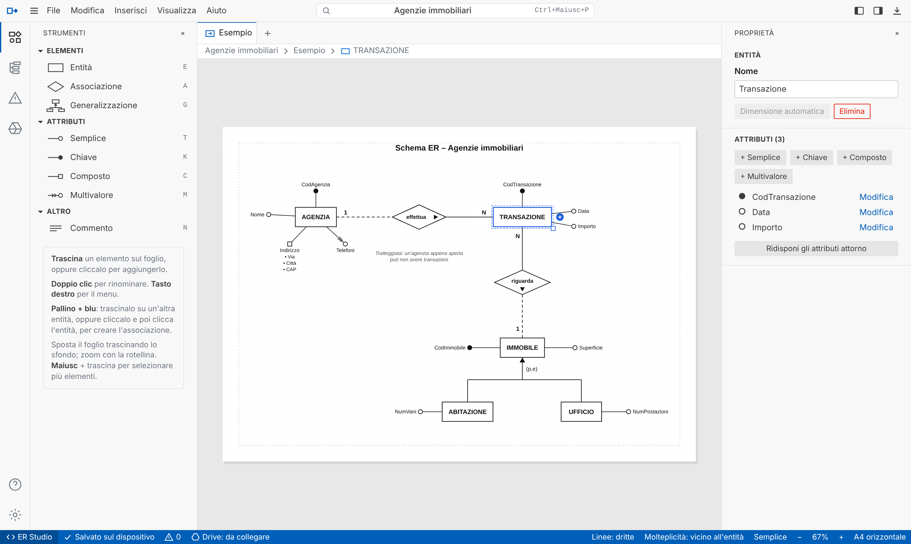
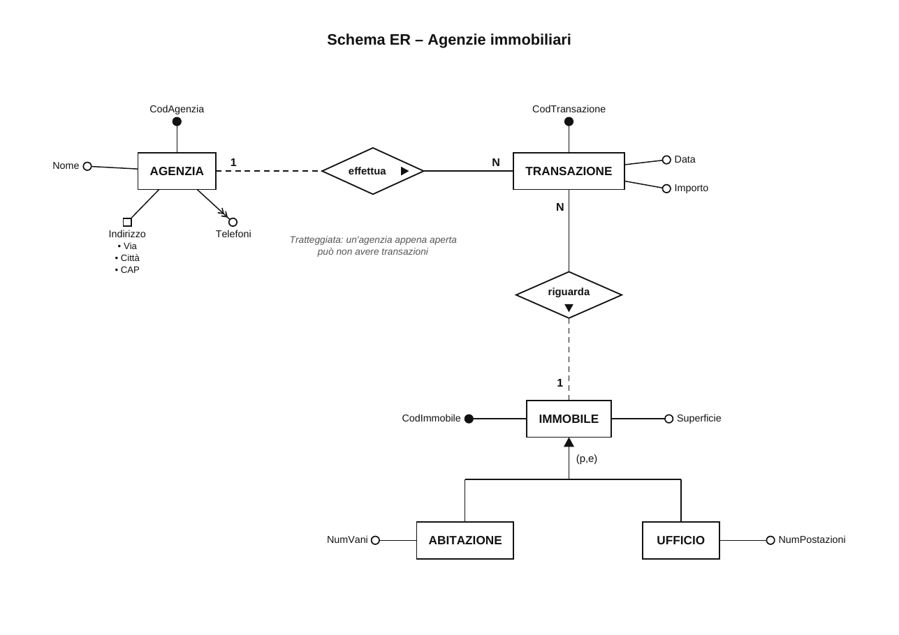
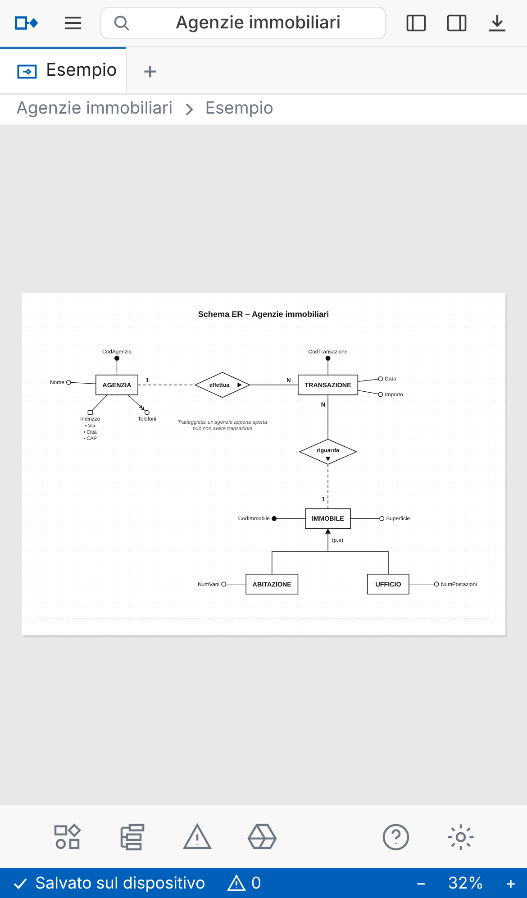

  

<h1 align="center">ER Studio</h1>

  Diagrammi Entità-Relazione in notazione Chen, pronti da consegnare in PDF. 
  <b><a href="https://lorenzodainelli.github.io/Diagramma-ER/">Apri l'app →</a></b>

  

## Cos'è

ER Studio è un editor per diagrammi ER che segue le convenzioni usate a scuola e
all'università: entità, associazioni, attributi, generalizzazioni, molteplicità.
Si usa dal browser, senza installare niente e senza account.

## Cosa sa fare

- **Notazione Chen completa**: entità, associazioni (anche ternarie e ricorsive),
  attributi semplici, chiave, composti e multivalore, generalizzazioni con copertura (t,e) / (p,s).
- **Partecipazione e molteplicità**: linea continua obbligatoria, tratteggiata facoltativa; 1, N, M.
- **Disposizione automatica**: un clic e il diagramma si ordina su una griglia, con linee
  dritte, associazioni tra le loro entità e attributi sui lati liberi.
- **Controllo degli errori**: segnala entità senza chiave, molteplicità mancanti, nomi doppi
  e associazioni incomplete, senza mai bloccarti.
- **PDF A4 orizzontale vettoriale**: nitido in stampa, e **riapribile**: carichi il PDF
  e torni a modificare il diagramma. I tuoi diagrammi restano salvati nel browser.
- **Anche PNG, SVG e JSON**, più fogli nello stesso progetto.
- **Sempre aggiornata**: si usa online dal browser, su computer e telefono.
- **Interfaccia in stile editor di codice**: barra comandi, scorciatoie da tastiera
  personalizzabili, pannelli ridimensionabili, menu contestuale.

<table>
  <tr>
    <td width="62%"></td>
    <td width="38%"></td>
  </tr>
  <tr>
    <td align="center">Il PDF esportato, A4 orizzontale</td>
    <td align="center">Sul telefono</td>
  </tr>
</table>

## In arrivo

- Salvataggio automatico su Google Drive
- Schema logico e SQL generati dal diagramma
- Interfaccia in inglese

## Licenza

ER Studio è software proprietario, **concesso in uso gratuito**: puoi usare l'app e i
diagrammi che crei sono tuoi, ma il software non può essere copiato, modificato o
ridistribuito. Dettagli in [LICENSE](LICENSE).

© 2026 Lorenzo Dainelli
